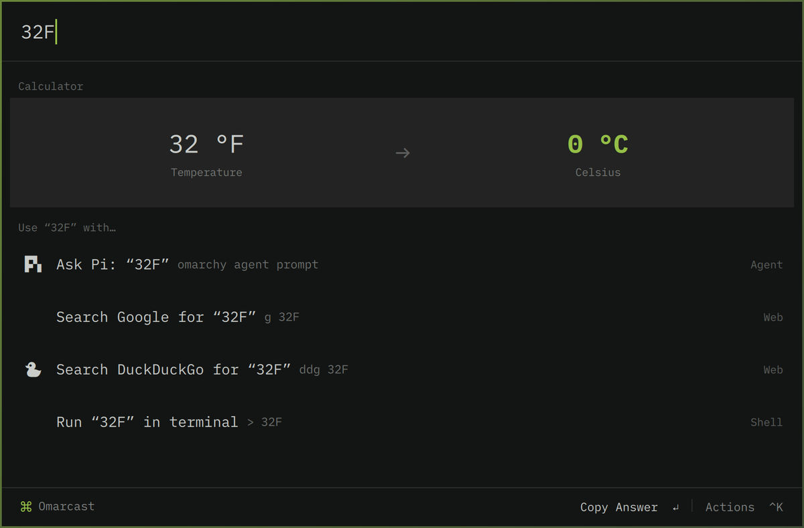
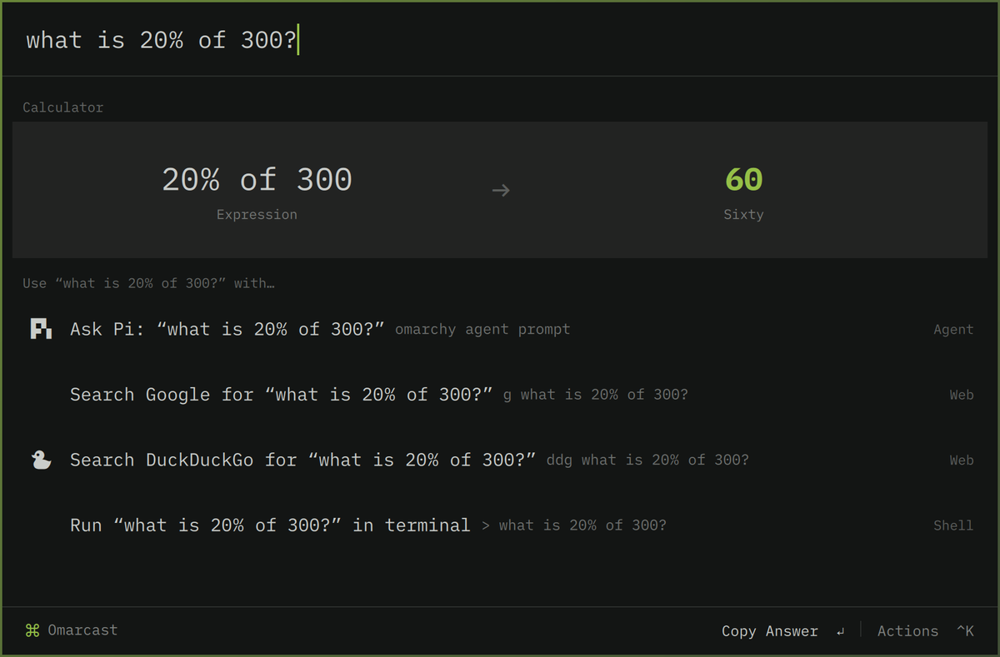
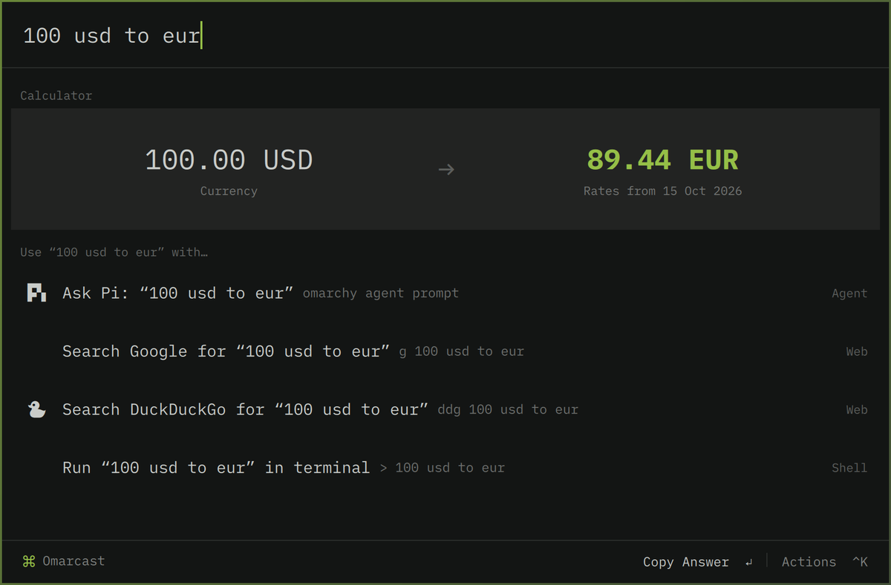
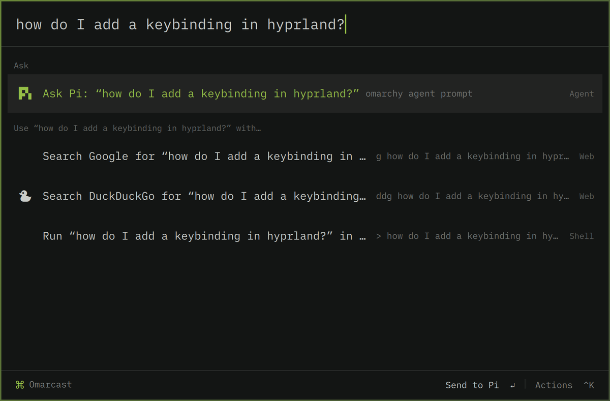
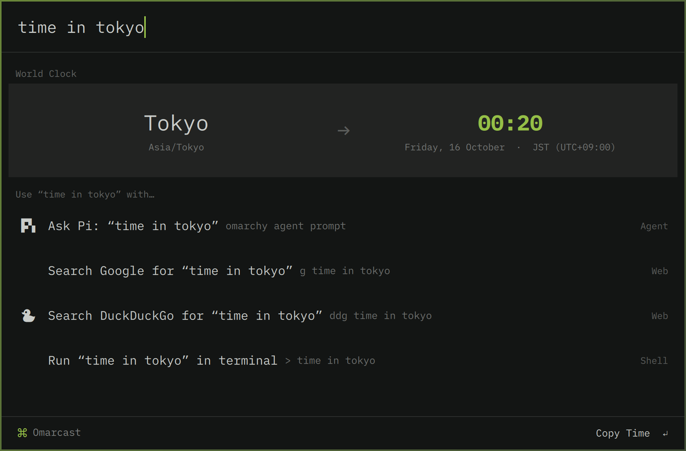
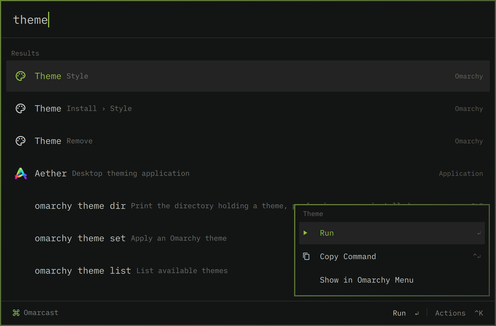
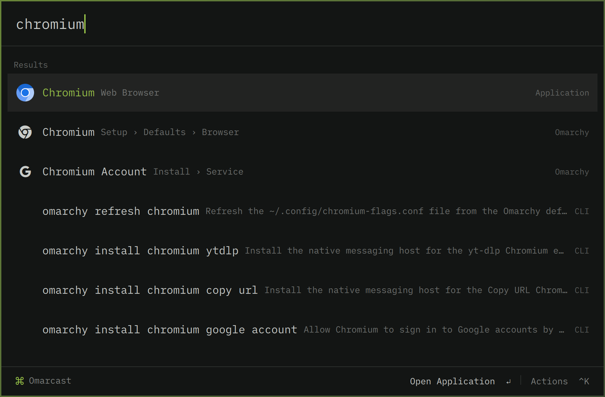
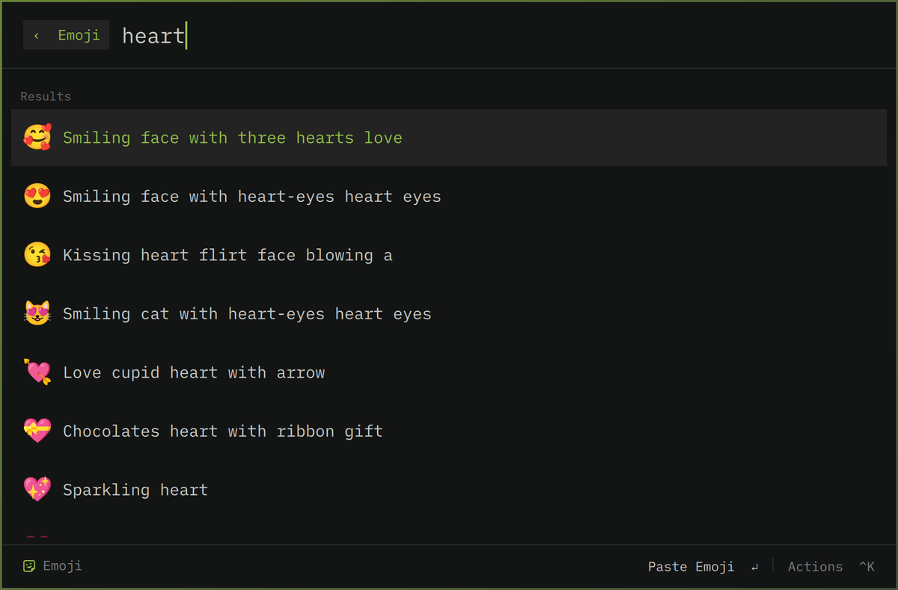
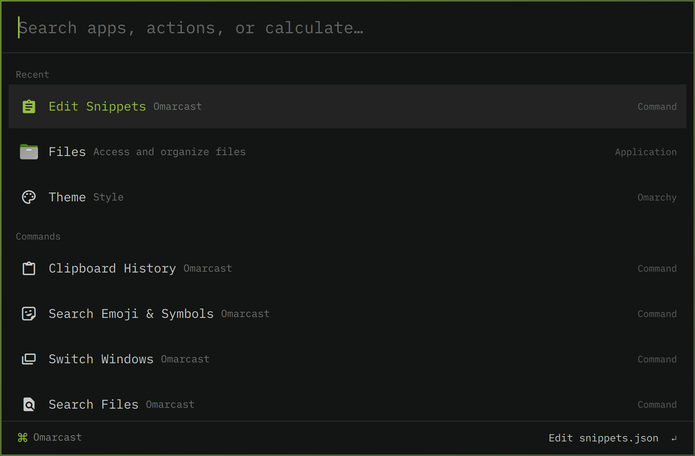

# Omarcast

A Raycast-style launcher for Omarchy that **replaces the Omarchy menu**. It's an
omarchy-shell plugin (`sehl.omarcast`) that declares `"clonedFrom": "omarchy.menu"`, so
everything that opens the Omarchy menu opens Omarcast instead: SUPER+SPACE, SUPER+ALT+SPACE,
the bar button, `omarchy menu <route>`, and the `omarchy menu select|input` pickers scripts use.
It shares the Omarchy menu's theme tokens, font, borders and corner rounding, and re-themes live.

No keybindings to set up: Omarchy's defaults (and Mac-style remaps like omac's ⌘Space)
already call `omarchy-menu`, which now routes here.



<table>
  <tr>
    <td></td>
    <td></td>
  </tr>
  <tr>
    <td align="center">Calculator answers questions — <kbd>↵</kbd> copies</td>
    <td align="center">Live currency rates</td>
  </tr>
  <tr>
    <td></td>
    <td></td>
  </tr>
  <tr>
    <td align="center">Anything else goes to your Omarchy agent</td>
    <td align="center">World clock</td>
  </tr>
  <tr>
    <td></td>
    <td></td>
  </tr>
  <tr>
    <td align="center">Every Omarchy action, with a <kbd>Ctrl</kbd>+<kbd>K</kbd> action panel</td>
    <td align="center">Apps, Omarchy settings and CLI commands</td>
  </tr>
  <tr>
    <td></td>
    <td></td>
  </tr>
  <tr>
    <td align="center">Emoji &amp; symbols</td>
    <td align="center">Recents and built-in commands</td>
  </tr>
</table>

Screenshots use the Omarchy theme active at the time; Omarcast follows whichever theme you switch to.

## What it does

Root search, type-first:

| Type | You get |
|---|---|
| `firefox`, `chrom` | Applications (Omarchy's app library: hidden entries, icons, launch feedback) |
| `theme`, `lock`, `wifi` | Every Omarchy menu action; submenus/pickers open the Omarchy menu at that spot |
| `app/fac` | Scope to applications: matched letters in **App**lication and **Fac**torio are highlighted |
| `stheme` | Fuzzy-match the complete breadcrumb **Style › Theme**, ahead of scattered CLI matches |
| `shortcuts`, `shortcut/workspace` | Live Omarchy/default and personal keyboard shortcuts; Enter copies, Ctrl+Enter opens the full action picker |
| `omarchy theme` | `omarchy` CLI commands (run in a terminal, or prefill args) |
| `1+1`, `2^10`, `sqrt(2)`, `20% of 50`, `5!`, `0xff`, `255 to hex` | Calculator card |
| `32F`, `5 km`, `6 ft in cm`, `1 GiB to MB`, `90 min to h` | Unit conversion card (length, mass, volume, area, speed, time, data, energy, angle, temperature) |
| `100 usd to eur`, `$20`, `10 eur` | Currency card (rates from open.er-api.com, cached 12h in `~/.cache/omarcast`) |
| `time in tokyo`, `nyc time` | World clock card |
| `gh omarchy`, `yt …`, `aur …`, `aw …` | Quicklinks |
| `omarchy.org` | Open URL |
| `> btop` | Run a shell command (terminal or background) |
| window titles | Switch to open windows |
| `how do I …?`, any 3+ word message | **Ask your default Omarchy agent** (`omarchy agent prompt`) — top result |
| anything else | Fallbacks: ask the agent, search Google / DuckDuckGo, run in terminal |

The **whole Omarchy menu** lives inside Omarcast: the empty query shows the Go… categories
(Apps, Learn, Trigger, Style, Setup, Install, Remove, Update, About, System), Enter drills in
with a breadcrumb (`Setup › Defaults › Browser`), ✓ marks the current choice, `when:` guards
hide what doesn't apply, Font/Power profile lists load live, and `omarchy menu power`-style
aliases open the right submenu. Your `~/.config/omarchy/extensions/omarchy-menu.jsonc` additions show up too.

Built-in commands (each opens its own view; Backspace on empty / Esc goes back):

- **Clipboard History** – Omarchy's clipboard history with text/image preview pane
- **Search Emoji & Symbols** – paste or copy
- **Switch Windows** – focus or close
- **Search Files** – `fd` over `~`, with preview pane
- **Keyboard Shortcuts** – the live `omarchy menu keybindings --print` index; Super+K still opens the stock actionable picker
- **Edit Quicklinks / Edit Snippets** – `~/.config/omarcast/{quicklinks,snippets}.json` (see `examples/`)

Keys: `↵` primary action · `Ctrl+↵` secondary · `Ctrl+K` action panel · `↑↓` / `Ctrl+N/P` ·
`Tab` opens a command's view · `Esc` clears → back → close.

`Backspace` at the start of the search (including an empty search) removes the
innermost submenu/view pill. Existing search text is retained when stepping out.
Ordinary text selection/deletion, modifier shortcuts and IME composition still
belong to the text field. Holding Backspace to clear text does not eat the pills.
Removing a script-picker pill cancels it without applying any selection.

Fuzzy ranking uses the scoring formula from [`tobi/try`](https://github.com/tobi/try):
word starts, proximity, early-match density and shorter names. A menu breadcrumb is
one structured name, so `stheme` matches `Style › Theme` rather than unrelated CLI
text. There are no categorical prefix/initialism tiers overriding those scores.
The UI shows and highlights the full breadcrumb when that is what matched.
Unrelated metadata fields stay separate and are discounted; scopes search names only.

Usage is remembered (`~/.local/state/omarcast/history.json`) and breaks equal-score
ties; the empty query shows Recent, Commands, Applications.

## Running applications

Running applications show **Application · Switch to → Desktop 3** on the right.
Enter switches to their most recently focused window instead of starting another
instance; **Launch Application** remains available in the action panel. Association
uses desktop IDs, declared startup classes and Quickshell's desktop-entry lookup,
never window titles. Chrome app-mode windows must match explicitly, keeping them
separate from normal browser windows and from other app profiles. Open, close,
focus and desktop-change events refresh the snapshot while the palette is open.
Window activation resolves the target live and switches its desktop before focusing
it; a window closed since the snapshot cannot materialize an empty desktop.

By default the desktop label uses Hyprland's workspace name. Custom desktop models
can provide their displayed labels with an optional argv array in
`~/.config/omarcast/config.json`:

```json
{ "workspaceLabelsCommand": ["my-desktop-labels", "--json"] }
```

The command writes a JSON object mapping exact workspace names to display labels,
for example `{"work":"Desktop 3"}`. It runs locally on open/explicit refresh and on
relevant compositor events while open; no shell interpolation is performed. Only
configure a command you trust. Until a configured provider supplies a label, the UI
shows `Desktop…` rather than exposing an internal workspace name. Use the desktop
model's authoritative current numbering, not a parked desktop's home number.

## Compatibility

Current Omarchy app-library wrappers are unwrapped and theme colors use an explicit
Commons alias. Stock multiple/immediate-change pickers preserve selection order,
Apply behavior and rollback. The installer validates and copies the package;
symlinked plugins are rejected by current Omarchy.

## Layout

```
plugin/              source, copied into ~/.config/omarchy/plugins/sehl.omarcast
  Omarcast.qml       UI, views, actions, data sources
  lib/Calc.js        calculator, units, currency, bases
  lib/Search.js      ranking + frecency
  lib/RunningApps.js  running-window association, desktop labels, safe activation
  lib/Sources.js     Omarchy menu/CLI parsing, windows, quicklinks, time zones, snippets
bin/omarcast-install validate/copy/reload the plugin (--no-restart only deploys files)
bin/omarcast-ui      toggle from a shell: omarcast-ui [clipboard|emoji|windows|files] [query]
dev/                 standalone harness (real Omarchy Commons/Ui) + screenshot helper
test/                node tests for lib/*.js
```

## Develop

```bash
npm test                         # portable calculator, search, navigation and running-app tests
npm run test:integration          # real Omarchy menu/CLI, live bindings and compositor
npm run test:live                 # live picker contracts and non-focusing UI previews
./bin/omarcast-install            # load edits (restarts omarchy-shell; cached QML otherwise)
qs -p dev                         # run standalone with QML errors on stdout
dev/shot '{"query":"32F"}'        # harness + screenshot to /tmp/omarcast-shot.png
```

Edit the Git checkout and rerun `./bin/omarcast-install`; do not edit the deployed
copy. Symlinked plugin packages are rejected by current Omarchy validation.
Search highlights are separate PlainText runs, so names cannot inject markup.
Category prefixes such as `app/`, `menu/`, `shortcut/`, `window/` and `cli/`
restrict matching to visible names; `app/` alone lists applications.

Bar icon: set `barIcon` / `barIconFont` in `~/.config/omarcast/config.json`, or `barIconImage` to an SVG or PNG path (drawn in the bar's text colour).

Uninstall: `omarchy plugin disable sehl.omarcast` (the stock Omarchy menu comes back) and
`rm -r ~/.config/omarchy/plugins/sehl.omarcast`.
